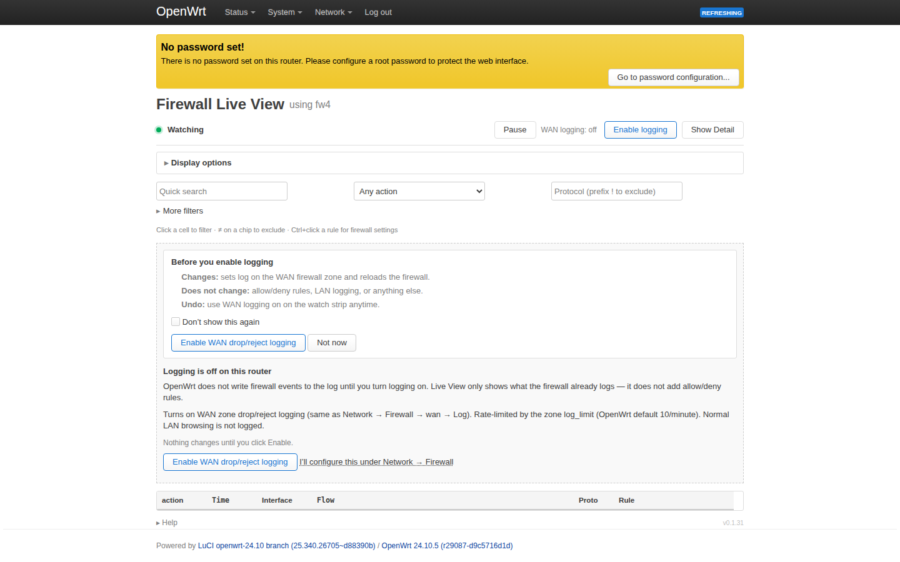
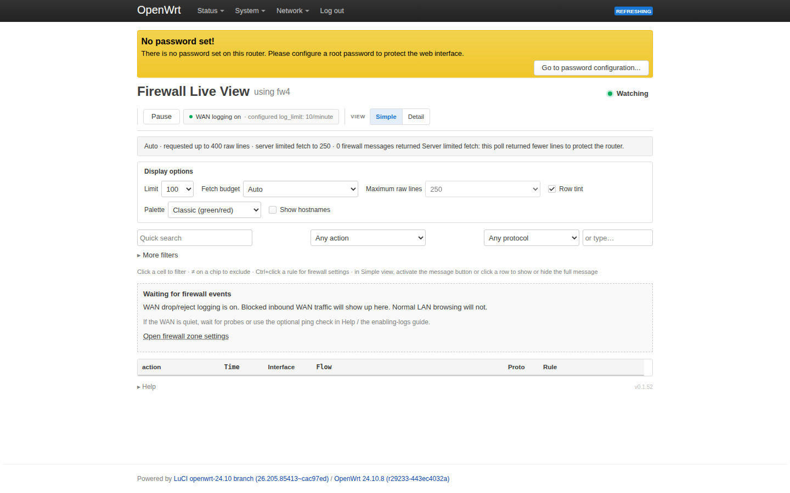
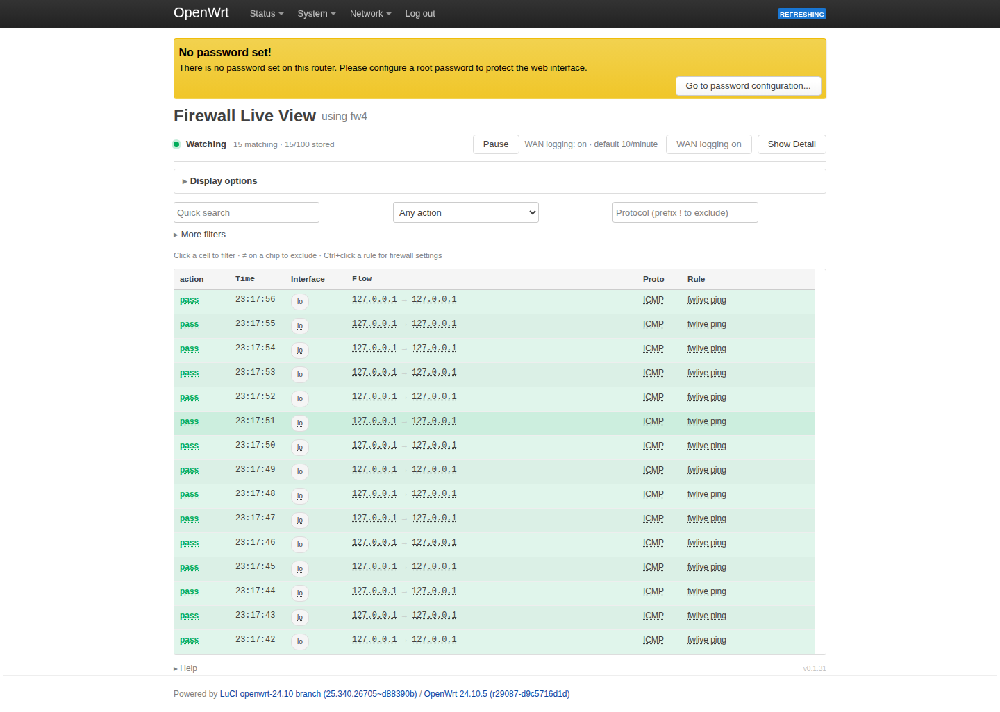
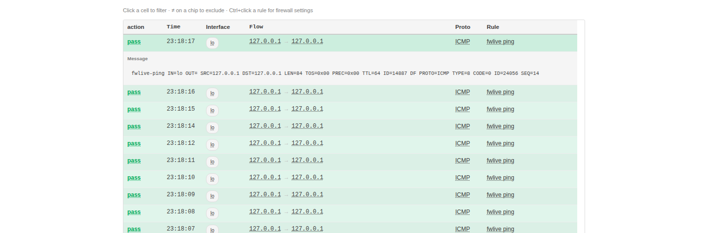
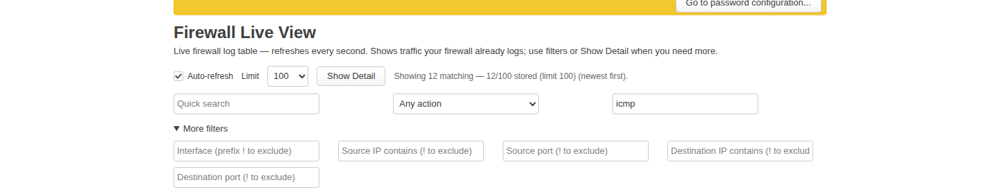
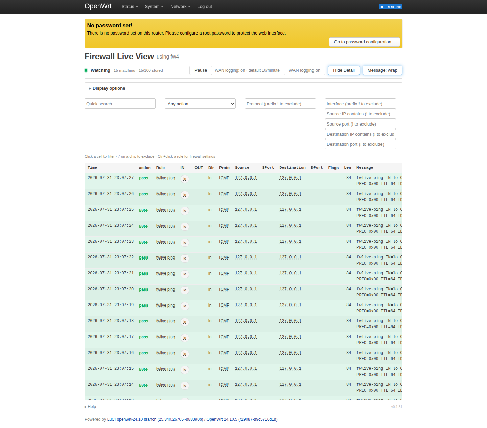

# Using the UI

Open **Status → Firewall Live View** in LuCI.

Live View shows **whatever OpenWrt is already logging**. Stock configurations log almost nothing — that is normal, not a broken install. Use **Enable logging** once for WAN drops/rejects (same as **Network → Firewall**). The app does not add allow/deny rules on its own.

On-page **Help** (collapsed at the bottom) covers the basics without leaving the router.

## First visit

### 1. Logging is off

1. **Title** — *Logging is off on this router* (cause first, not “broken table”).
2. **Before you enable logging** — one-time panel: what changes, what does not, how to undo.
3. **Enable logging** — intentional step; or pick **Not now**, or configure zones under **Network → Firewall** yourself.
4. Watch strip shows a short **Enable logging** button.

Nothing changes until you click **Enable logging**.

### 2. After you enable

1. Watch strip shows a single **WAN logging on · configured limit** control (click to disable).
2. A green notice shows that WAN drop/reject logging is on — not normal LAN browsing.
3. If the table is still empty, you are **waiting for firewall events** (quiet WAN). Blocked inbound traffic appears as it happens.

Optional synthetic check: [Enabling firewall logs → ping test](enabling-firewall-logs.md#2-optional--confirm-the-ui-with-a-ping).

## Simple view (default)

1. **Title row** — **Firewall Live View** on the left; **Watching** status (dot + counts) on the right.
2. **Watch strip** — Pause/Resume, **Clear**, logging control, and segmented **Simple / Detail** and **Wrap / One line** groups.
3. **Display options bar** — **Limit**, **Row tint**, **Palette**, and **Show hostnames** on one line (no drawer). **Fetch budget** and **Maximum raw lines** stay in **Detail**.
4. **Filter row** — quick search, Action, and Protocol (grouped menu + optional custom type-in); open **More filters** for the rest.
5. **Table** — click a filter link (action, IP, protocol, interface, flow endpoint) to filter. In **Simple** view, activate **Show full message** or click a row body such as the **Time** cell to expand Message.

| Column | Meaning |
|--------|---------|
| **Action** | pass, drop, reject, etc. — color-coded |
| **Time** | Compact `HH:MM:SS` (today) |
| **Interface** | Interface badge: **IN** when present, otherwise **OUT** (Detail view shows separate IN/OUT and direction) |
| **Flow** | `source:port → destination:port` — click parts to filter |
| **Proto** | TCP, UDP, ICMP, … |
| **Rule** | Resolved fw4/UCI name when possible |

**Expand raw message:** activate **Show full message** (▸ in the Action cell) or click any data row that is not a filter link. The full netfilter log line appears below that row. **Hide full message** or a second row click collapses it.

1. Activate **Show full message**, or click the row body (for example the **Time** cell), to expand.
2. The full log line appears under that row — **Hide full message** or click the row again to collapse.

### Simple filters

Quick search, **Action**, and **Protocol** are always visible. Protocol offers common values in a menu; type in the adjacent field for anything else (prefix `!` to exclude). Open **More filters** for interface, source/destination, and ports.

1. Active filters appear as **chips** under the search bar.
2. Click **≠** on a chip to flip include ↔ exclude; **×** removes one; **Clear all** resets.
3. **More filters** reveals interface, addresses, and ports.

## Detailed view

Click **Detail** on the watch strip (the active segment is highlighted). Click **Simple** to return.

1. **Detail** switches to the forensic table and uses the full browser width (Simple keeps LuCI's normal column) — widen the window to see more per row.
2. Every normalized field is visible in one row (including Message).
3. **Wrap / One line** (next to Simple / Detail) applies in Detailed view only.

Shows every normalized field in one wide table:

Time, Action, Rule, IN, OUT, Dir, Proto, Source, SPort, Destination, DPort, Flags, Len, **Message**

Use Detailed when you need the raw `KEY=value` message inline without expanding rows, or when debugging flags, length, and direction fields.

## Shared controls

| Control | Behavior |
|---------|----------|
| **Pause / Resume** | Live updates run until you Pause. Resume continues the table. Polling never stops. |
| **Clear** | Empties the table. Events already shown stay hidden for this session; new events still appear. |
| **Enable logging** | Filled button on the watch strip when WAN logging is off. Sets WAN zone drop/reject logging (same as Network → Firewall). No allow/deny rules are added. Concurrent toggles from multiple admins serialize under an exclusive file lock (`flock`). A caller retries across five one-second intervals for the short read→commit section, then reports a lock error if contention remains (plus scheduling overhead). Firewall reload runs after the lock is released. Each toggle re-reads WAN state under the lock before committing. On fw4 builds that support per-zone `log_limit`, the WAN zone setting configures that limiter; the fw4 bundled with OpenWrt 23.05.5 ignores it, and a configured value on another build does not prove it is active. Kernel/logd may still constrain total log volume. |
| **WAN logging on · configured limit** | When logging is on, one merged control shows status and the configured WAN zone `log_limit`. The configured value does not confirm that the active fw4 applies it. Click it to disable. |
| **Simple / Detail** | Segmented pair on the watch strip. The active segment is highlighted. Preferences saved in `localStorage`. |
| **Wrap / One line** | Segmented pair next to Simple / Detail. Visible in Detailed view only. |
| **Display options** | Inline bar below the watch strip: **Limit**, **Row tint** (checkbox + palette), and **Show hostnames**. **Fetch budget** and **Maximum raw lines** are in **Detail** view. |
| **Limit** | Rows to keep (25 … 2000, default 100). Stored in the browser. On a router reported as a weak device, the browser renders at most 250 rows and explains the cap in the status line; the larger limit remains available for buffering and stronger devices. |
| **Fetch budget** | Visible in **Detail** view. **Auto** reads extra kernel log lines so the table can fill; that count is not the same as **Limit**. **Manual** selects a bounded maximum from 25, 50, 100, 250, 500, 1000, or 2000. Both modes retain server protection and adaptive polling cadence. |
| **Maximum raw lines** | Visible in **Detail** view. Enabled in **Manual** mode. It is a raw-line fetch budget, not a number of firewall rows displayed. Paused Manual fetches use this maximum; paused Auto keeps the compatibility 2000-line request. |
| **Show hostnames** | Off by default. When checked, resolved names replace IPs in **Flow** and address columns. Hover shows the IP. Click still filters by IP. |
| **Quick search** | Matches across all normalized fields. |

## Performance on small devices

For a responsive display on a weak router or an older client, keep **Limit** at
250 rows or below. A router-reported weak-device cap limits how many rows the
browser renders; the selected limit can still allow the in-memory buffer to
retain more rows for filtering and stronger devices.

Switching to another browser tab pauses polling. Returning to fwlive performs
one catch-up poll, then resumes the normal cadence. **Show hostnames** is off by
default because reverse-DNS lookups add work; leave it off when the router or
browser is busy.

When adaptive polling is active, a live poll longer than 1.5 seconds may enter
**Summary mode** automatically: the table is replaced by a **Summary** card
with compact counts from the current sample. Three consecutive fast polls
(under 300 ms each) restore the table automatically. Click **Show rows** to
bring it back sooner; **Hide rows** returns to the card. Polling continues and
filters still apply — the switch trims render work on a busy client or router,
not a frozen display.

**Watching** names conditions you can act on. Fetch-budget counts, poll-cap
details, and other scaling internals stay off the shipped page. Add `#diag=1`
to the page URL for that diagnostic banner and the extra tags; the flag lives
in the hash only (it is not stored in the browser).

| Status line | Meaning |
|---|---|
| **table refresh throttled** | Events arrive faster than the browser should repaint; the buffer still updates. |
| **display limited to 250 rows** | On a weak device the table paints at most 250 rows; a larger Limit still buffers rows. |
| **scroll frozen — scroll to top to follow live** | The table is not following new rows; scroll to the top to resume. |
| **buffer filling** / **buffer full** / **loading buffer** | Pause is holding a snapshot while the buffer catches up or is at capacity. |

When a poll fails, the status line says **Connection lost — retrying…** if no
reply arrived, **The router could not read the firewall log — retrying…** if
the router answered with an error, and **Installation is incomplete. Reinstall
luci-app-fwlive.** when a required package file is missing (retrying cannot fix
that).

After a successful poll with no current firewall entries, the status line can
show **“Firewall log has no current entries; showing rows last received %s
ago.”** while previously received rows remain buffered. It appears once at
least 15 seconds have passed since the last non-empty batch. The age is rounded
down: seconds below one minute, minutes below one hour, hours below one day,
then days. New rows reset the age; a poll error takes precedence over this hint.

The router's log ring is finite and may evict older events before fwlive reads
them. fwlive cannot recover evicted entries and does not change forwarding
behavior. If events arrive faster than the UI can display them, use a lower
**Limit**, keep hostname lookup disabled, and rely on the high-rate banner as a
signal to reduce the workload.

## Filtering

- **Click a filter link** (action, IP, protocol, interface, flow endpoint) to filter. In **Simple** view, the **Time** cell is not a filter link; clicking it expands the row, as does **Show full message**. In **Detail** view, that click does not expand the row and there is no message button.
- Active filters appear as **chips** — click **≠** on a chip to flip include ↔ exclude; **×** removes one; **Clear all** resets.
- You can also prefix text filters with **`!`** for negation (same as **≠** on a chip).
- **URL hash** stores filters, limit, `view=detailed`, and in Manual mode `poll=manual` plus `maxraw=` (raw-line fetch budget) for shareable links. `#diag=1` is a session diagnostic flag, not a filter.

Source and Destination IP fields match substrings without regard to case, so
uppercase IPv6 hex matches lowercase log addresses. Prefix `!` to exclude the
matching substring.

### Filter tips

| Goal | Approach |
|------|------------|
| See only drops | Action → `drop` |
| Hide passes | Click **pass** in the table, then **≠** on the `action: pass` chip |
| One client | Click source in **Flow** or use **More filters → Source** (substring match — e.g. `10.0.0.1` also matches `10.0.0.10`) |
| ICMP test | Protocol → `ICMP` after [enabling ping logging](enabling-firewall-logs.md) |

## Rule column

When fw4 logs a **prefix** (for example, `fwlive-ping` followed by a space), the UI shows a label. Ctrl+click (Cmd+click on macOS) a rule name to open the firewall configuration; plain click filters on that hint.

If **Some rule names may be missing** appears near the title, open **Details**
for the cause and diagnostic code. Some entries may use names derived from log
prefixes, so searching by a friendly rule name may miss them. Rule-name lookup
does not change your firewall rules. The live counter and paused status remain
available; a failed refresh keeps previously loaded names when available.

## Empty table

If no events appear after install, that is expected until logging is on — see [First visit](#first-visit). **Enable logging** sets the zone's filter-log bit (bit 0 of `log`) and keeps other bits (same as **Network → Firewall**). The empty state explains what will and will not appear (WAN drops/rejects, not normal LAN browsing).

If logging is already on but the table is still empty, wait for inbound WAN traffic or see **[Quick start — optional ping test](enabling-firewall-logs.md#2-optional--confirm-the-ui-with-a-ping)**. Advanced setup: **[Enabling firewall logs](enabling-firewall-logs.md)**.

## High traffic rate

If more than ~250 **new** events arrive per second, a banner may appear and
some frames are skipped while the render budget refills. Under a sustained
flood, the scheduler still paints periodically even when one batch is larger
than the per-second budget; the table should not remain frozen until traffic
slows or a control changes.

With `#diag=1` in the URL, a gray banner can distinguish the requested raw-line
budget, a successful server-applied limit, and the classified messages
returned. The shipped Simple and Detail views omit that banner.
Fewer returned messages do not by themselves prove shedding: filtering, sparse
logs, deduplication, and finite router log retention can all reduce the result.
While paused in Manual mode, the status line says **buffer filling** when
successive full or growing snapshots are still adding rows; it clears on a
short read, an unchanged snapshot, an error, or Resume.

## Related reading

- [Overview](overview.md)
- [Enabling firewall logs](enabling-firewall-logs.md)
